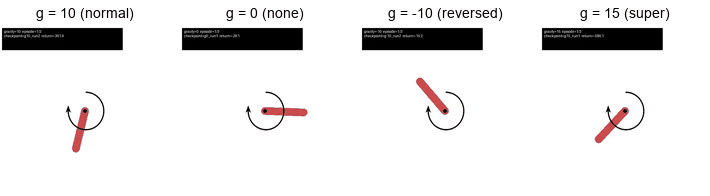
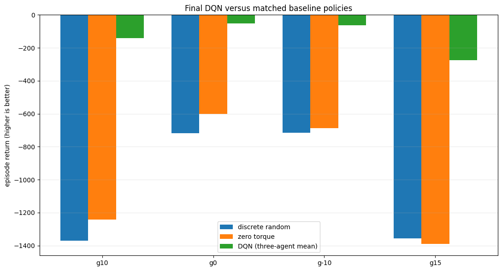
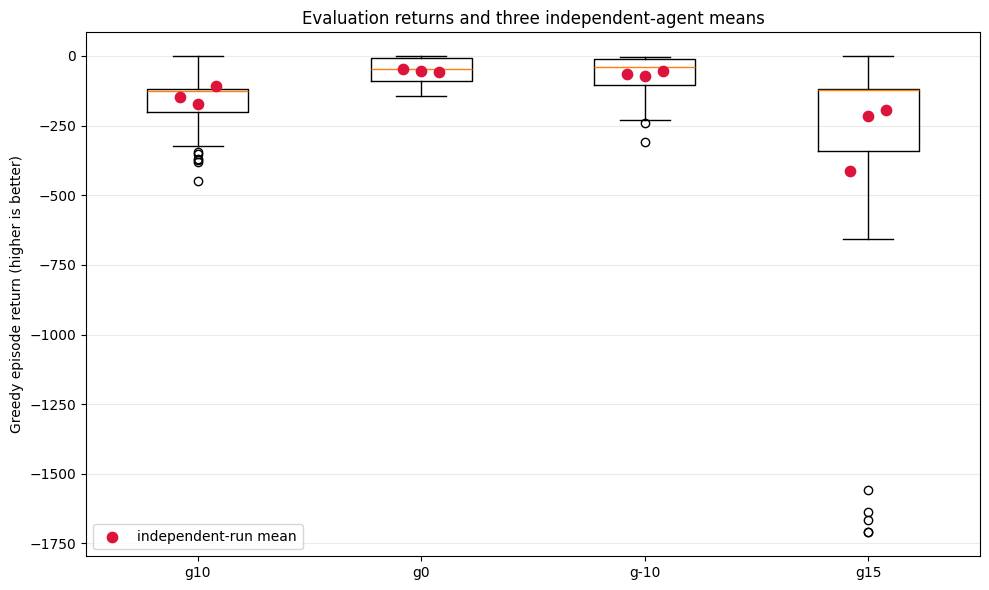
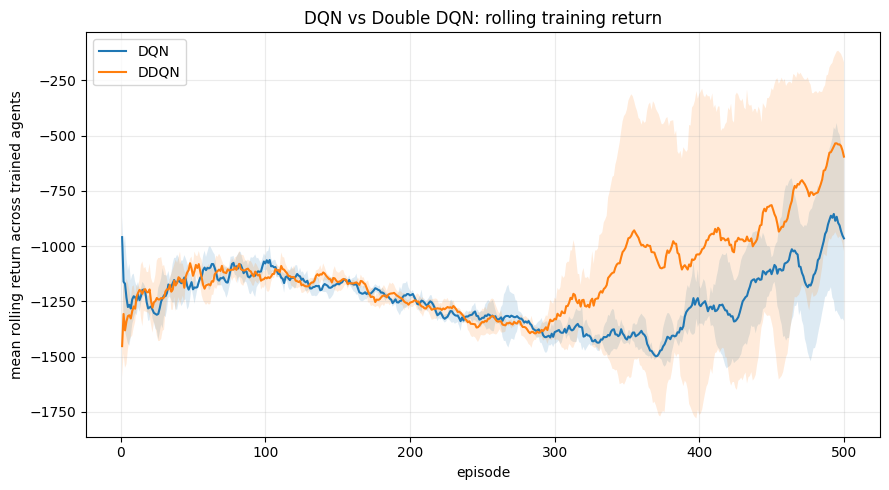
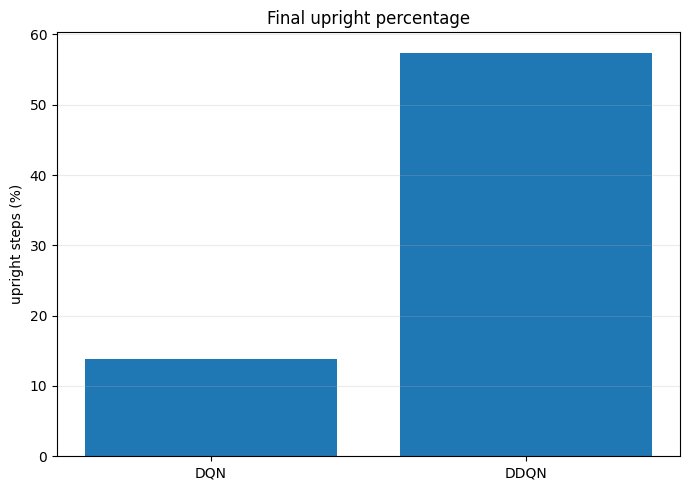

# DQN Pendulum Control Under Four Gravity Settings

Training **Deep Q-Network (DQN)** agents to swing up and balance an inverted pendulum (OpenAI Gym `Pendulum-v0`) under normal, zero, reversed and stronger gravity, then testing whether **Double DQN** improves on standard DQN. Built in TensorFlow/Keras.

*The first demo episode for each gravity, played by a reloaded saved agent. The g = 15 clip is that gravity's weakest of three demo episodes (return about −586), which is why it takes longer to settle.*

This has two parts:

| | Who |
|---|---|
| **Gravity study:** one DQN design trained at g = 10, 0, −10 and 15 | Joint project with **You Xuan** |
| **Double DQN experiment:** standard DQN vs Double DQN at g = 10 | **Hoon Chun Fei** (solo) |

Within the joint gravity study:

| | Who |
|---|---|
| DQN implementation and evaluation protocol | **Joint** |
| Action-count screening for g = 10 and g = −10 | **Hoon Chun Fei** (me) |
| Action-count screening for g = 0 and g = 15; hard vs soft target-update comparison | **You Xuan** |
| Final agents: all three at g = 10, two at g = −10, one at g = 15 | **Hoon Chun Fei** |
| Final agents: all three at g = 0, one at g = −10, two at g = 15 | **You Xuan** |
| Merging all 12 checkpoints, the final 30-episode evaluation, demo videos | **Hoon Chun Fei** |

## The problem

The pendulum starts at a random angle and the agent must swing it upright and hold it there using a torque between −2 and +2. DQN can only pick from a fixed list of actions, so the torque range was split into an odd number of evenly spaced values that always includes zero (for example `[-2, -1, 0, 1, 2]`).

Changing gravity changes the physics completely: with no gravity, nothing pulls the pendulum down; with reversed gravity, it falls *towards* the top; with stronger gravity, the same maximum torque is weaker by comparison.

## Approach

- **DQN** with experience replay, a separate target network (copied once per episode) and normalised state inputs.
- **Action count screened per gravity** (3, 5 or 9 actions; 5, 9 or 15 at g = 15). Selected: 5 at g = 10, 9 at g = 0, 5 at g = −10, 15 at g = 15.
- **Hard vs soft target updates** compared at g = 10. Hard updates scored about the same (−154.9 vs −157.0 best validation return) in under half the time (2.7 vs 5.9 minutes), so the simpler method was kept.
- **Three independently initialised agents per gravity**, each trained for at least 500 episodes and stopped only when both the recent training return and a greedy validation check reached −200 (otherwise training continued up to 2,000 episodes).
- **Held-out evaluation:** every saved agent was reloaded and tested on 30 fresh episodes it had never seen. Results are the mean (± SD) of the three agents, so one lucky agent can't carry a gravity.

## Results: gravity study

| Gravity | Actions | DQN return ↑ (3 agents) | Random policy | Zero torque | Time upright | Episodes reaching upright |
|---|---|---|---|---|---|---|
| g = 10 (normal) | 5 | **−142.6** ± 33.7 | −1,370.1 | −1,241.4 | 83.5% | 100% |
| g = 0 (none) | 9 | **−52.3** ± 6.8 | −717.6 | −601.6 | 86.1% | 100% |
| g = −10 (reversed) | 5 | **−63.4** ± 9.8 | −714.5 | −688.4 | 86.5% | 100% |
| g = 15 (super) | 15 | **−274.0** ± 119.2 | −1,356.5 | −1,390.9 | 78.0% | 94.4% |

- **DQN learned every setting**, far ahead of the random and zero-torque baselines.
- **Zero and reversed gravity were easiest:** best returns and the smallest spread between agents.
- **Stronger gravity was hardest:** worst return, largest spread, and the only setting where some episodes never reached upright.

**An honest weak spot:** one of my g = 15 agents scored −107.4 on its 10-episode validation check, but averaged −411.2 on the 30 held-out episodes. It stays in the results, because removing it would hide exactly the instability the evaluation is meant to catch.

## Results: Double DQN experiment (solo)

Double DQN changes one thing: the online network picks the next action and the target network scores it, instead of the target network doing both. Everything else (network, replay, exploration, the 500-episode budget) was held identical, with three agents each at g = 10.

| Metric | DQN | Double DQN |
|---|---|---|
| Mean return ↑ | −781.5 | **−548.6** |
| SD across the 3 agents ↓ | **463.1** | 597.7 |
| Time upright ↑ | 13.8% | **57.4%** |
| Longest upright stretch ↑ (steps) | 8.6 | **114.7** |
| Episodes reaching upright | 72.2% | 72.2% |
| Mean max Q-value (diagnostic) | 544.1 | 223.2 |

- **Double DQN balanced far better:** two of its three agents held the pendulum upright for about 78–80% of the time, while no DQN agent passed 22.7%.
- **Both reached upright equally often (72.2%).** The difference was *staying* there.
- **It was not more consistent:** one Double DQN agent failed (−1,238.6), so its spread across agents was larger.
- **Q-values were less extreme on average.** The worst DQN agent had the highest Q-value estimate (1,462.9) and the worst return (−1,305.7). That pattern matches the overestimation problem Double DQN targets, but without true values it isn't proof.

**Why this DQN baseline (−781.5) is much worse than the gravity study's g = 10 result (−142.6):** the gravity study kept training each agent until it hit the −200 target (504 to 650 episodes at g = 10), while this experiment stops every agent at exactly 500 episodes. The training curves above are still rising near episode 500, so neither method had fully converged.

## What I learned

- **Judge an agent on held-out episodes, not its best validation score.** The g = 15 agent that looked great in validation was the clearest example.
- **Train several agents.** RL runs vary a lot. Reporting the spread across three agents told a more honest story than any single run.
- **Keep the simpler option when it ties.** Soft target updates doubled the training time for no gain.
- **Reaching a goal and holding it are different skills.** Double DQN's advantage only showed up in the "stay upright" metrics.

## Repository contents

| Path | What it is |
|---|---|
| `notebooks/dqn_pendulum_gravity.ipynb` | The joint gravity study (my copy), with all outputs and embedded demo videos |
| `notebooks/dqn_vs_double_dqn.ipynb` | My Double DQN experiment, with all outputs |
| `results/checkpoints/` | All 12 trained agents: weights, config and training history |
| `results/screening/`, `baselines/`, `evaluation/` | Action-count screening runs, baseline policies and per-episode evaluation data |
| `results/videos/` | Three-episode MP4 demos for each gravity |

The notebooks keep their outputs, so every chart and table is readable without running anything. They use Gym 0.17.3, which needs an older Python stack (Python 3.9, TensorFlow 2.10, NumPy < 2; see `requirements.txt`). With every training flag left at `False`, the gravity study notebook rebuilds its charts from `results/` without retraining. The Double DQN experiment's raw output files aren't included, only its notebook outputs.
